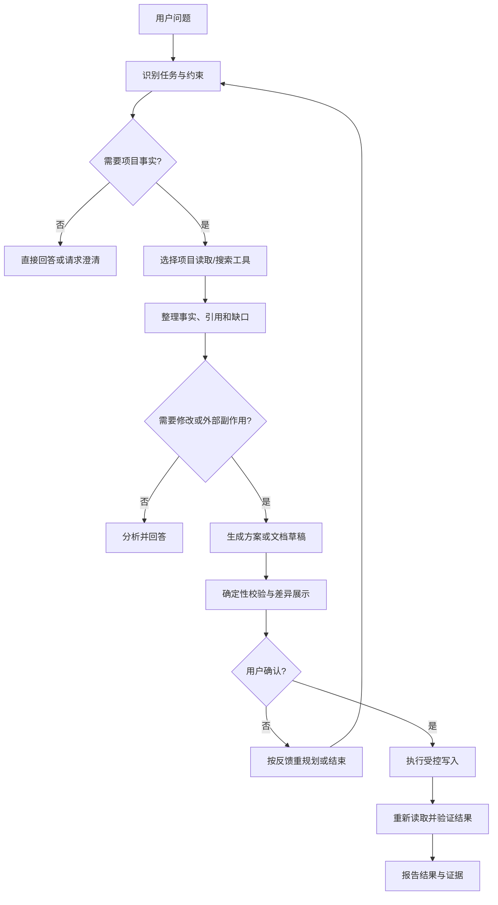
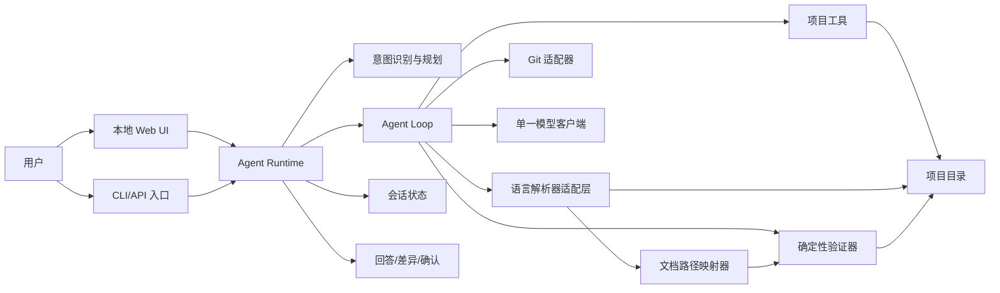

# 项目知识与文档助手 Agent 设计文档

状态：草案  
目标实现语言：Python 3.11+

## 1. 定位

这是一个**面向当前项目、专精项目知识与文档工作的 Agent**。它可以规划并完成多步骤任务，读取和修改项目文件、运行验证，并接入用户启用的网页、浏览器、MCP 与多模态能力。文档工作流包括理解项目、回答问题、查找依据、分析需求、制定方案、起草文档、评审文档和按确认结果修改文档。

“专精”体现在项目证据、文档工作流和确定性校验上。Agent 的默认工作范围是当前项目；用户可逐项启用网页、隔离浏览器和 MCP 能力。项目检查命令按项目配置授权，其他 Shell 命令逐次确认；外部副作用逐次确认，Git 提交始终由用户确认。

## 2. 目标与原则

### 2.1 目标

- 用户用自然语言提出项目相关问题，不必先选择复杂的功能菜单。
- Agent 能识别任务类型并选择合适的步骤和工具。
- Agent 能读取项目资料、保留来源、提出澄清问题、执行有限操作并验证结果。
- Agent 能扫描项目源码，并为每个纳入范围的代码文件生成对应的结构化文档。
- Agent 能读取文档目录的 Git 变更记录，帮助用户比较和总结文档优化方向。
- 高风险动作（修改文件、覆盖文档）必须经过用户确认。
- 任务完成由验证结果决定，不由模型一句“已完成”决定。

### 2.2 Agent 最小闭环

Agent 保留一条主闭环：读取证据 → 规划任务 → 调用授权能力 → 校验结果 → 展示 Diff 或请求确认 → 汇报。SQLite 保存本地会话和任务事件历史；进程重启后不恢复正在执行的模型/工具循环。长期记忆默认关闭，启用后可查看和删除。

## 3. 代码与文档镜像

这是产品的核心特性：代码目录和代码文档目录保持可计算的一一对应关系。

### 3.1 映射规则

映射规则与实现语言无关。Agent Runtime 使用 Python 构建，但代码文件由语言适配器按扩展名选择解析器。设源码根目录为 `source_root`，文档根目录为 `docs_root`：

```python
relative = source_path.relative_to(project_root)
document_path = docs_root / relative.parent / f"{relative.name}.md"
```

例如：

```text
project/
├── src/
│   └── auth/
│       ├── __init__.py
│       └── token.py
└── docs/
    └── code-reference/
        └── src/
            └── auth/
                ├── __init__.py.md
                └── token.py.md
```

映射约束：

- 每个纳入扫描范围的代码文件必须对应一个 Markdown 文件，不能合并多个源码文件，也不能让一个源码文件对应多个文档。
- 目录层级和文件名保持一致；例如 `__init__.py` 也单独生成 `__init__.py.md`。
- 文档默认放在 `docs/code-reference/`，避免和用户手写的需求、架构、README 文档混在一起。
- 文档标题使用源码相对路径；同步状态只在 UI 和 Runtime 中显示。
- 源码删除或移动时只报告孤立文档和建议动作，不自动删除用户文件；用户确认后才清理或移动。
- 代码扩展名由语言适配器注册表决定；没有适配器的文件不自动进入结构同步，避免把未知文本当成代码。
- 首版不自动生成目录级汇总文档，避免破坏严格的一对一关系；需要项目总览时由 Agent 另行生成。

### 3.2 文档目录与源码目录绑定

一个文档目录绑定一个源码目录，绑定关系决定文档与源码的对应路径、解析范围和“查看源码”按钮的目标。首版只支持一组绑定。

建议保存在项目根目录的 `.docsagent.toml` 中：

```toml
[binding]
docs_root = "docs/code-reference"
source_root = "src"
```

- `docs_root` 和 `source_root` 都必须位于项目根目录内，解析符号链接后仍不能越界。
- `docs_root` 和 `source_root` 不能互相包含；当源码根目录是项目根目录时，Runtime 会显式排除文档输出目录，避免重复扫描。
- Runtime 内置排除 `.git`、依赖缓存、虚拟环境和文档输出目录；语言适配器决定可扫描的文件扩展名。
- 绑定建立后，Agent 可以直接扫描源码、解析结构、维护同步状态和生成文档；没有绑定时只做普通 Markdown 文档处理。
- 绑定切换会校验路径，并在同步任务或待审提案存在时拒绝切换，避免旧草稿与新目录混用。
- 源码文件不存在、绑定失效或语言适配器不可用时，文档仍保留，但“查看源码”显示明确原因，不能静默指向其他文件。

### 3.3 文件内容要求

每个代码文件的文档至少包含：

1. 文件职责和对外作用。
2. 导入依赖和被依赖的项目模块（静态可识别部分）。
3. 模块级变量和类属性，按作用域分组；重复赋值合并记录。
4. 类、方法和函数的签名、功能与结果、参数和异常。
5. 每个函数或方法自己的参数和局部变量，放在该函数说明内部，紧接实现方式说明。
6. 函数和方法的实现方式：主要控制流、算法或转换步骤、关键调用、状态变化和外部 I/O。
7. 每项事实对应可点击的符号或文档锚点，以及无法静态确认的内容。

局部变量按当前语言解析器能识别的命名绑定记录，包括赋值目标、循环变量和闭包/推导式变量。它们不再单独堆在文件级变量表中，而是归入所属函数或方法，按“参数 → 局部变量 → 功能与结果 → 实现方式 → 异常”的顺序展示。通过反射、动态加载、宏或运行时注入产生的成员无法可靠静态提取时，文档必须标记为“静态分析无法确认”，不能让模型补写成事实。

文档统一使用 UTF-8 Markdown；每个文件只有一个一级标题，代码块标注语言，自动生成区域不能静默覆盖用户补充。

### 3.4 解析与生成分工

- 语言适配器负责确定性提取文件、导入、变量、类、函数、参数、控制结构和源码范围，保证结构清单不由模型猜测。Python 适配器使用标准库 `ast`；启发式语言适配器必须公开解析限制。
- 所有语言适配器都输出统一的 `CodeFacts`：语言、文件路径、符号类型、名称、作用域、签名、变量、依赖、内部源码范围和解析诊断；Runtime、Diff 和 Markdown 模板不依赖具体语言。
- 每个可引用的定义生成稳定 `symbol_id` 和文档锚点；调用处、依赖项和其他符号引用使用链接跳转到目标文档的定义章节。解析器同时产出调用边，供“查看实现链路”使用。源码范围只用于内部定位和“查看源码”，不作为可见字段输出。
- 模型接收语言解析器摘要和必要的源码片段，负责用自然语言说明文件职责、函数功能和实现方式。
- 模型只能解释解析器提供的事实；无法从代码和项目上下文判断时写入“待确认”，不猜测业务含义。
- 文档生成后由验证器检查：源码中的每个结构项是否出现在文档中、符号链接目标是否存在、文档同步状态是否有效以及目标路径是否符合映射规则。

### 3.5 单文件文档示例

下面以 `src/auth/token.py` 作为 Python 文件示例；示例格式同样适用于其他语言的对应适配器：

```python
import os
from project.crypto import sign

SECRET_ENV = "AUTH_SECRET"

def create_access_token(user_id: str, expires_in: int = 3600) -> str:
    payload = {"sub": user_id, "exp": expires_in}
    return _encode_payload(payload)

def _encode_payload(payload: dict[str, object]) -> str:
    secret = os.environ[SECRET_ENV]
    return sign(payload, secret)
```

Agent 生成的 `docs/code-reference/src/auth/token.py.md` 示例：

```markdown
# `src/auth/token.py`

## 1. 文件职责

该文件负责根据用户标识创建访问令牌，并使用环境变量中的密钥对令牌载荷签名。

## 2. 依赖

| 名称 | 类型 | 说明 |
| --- | --- | --- |
| `os` | 标准库模块 | 读取签名密钥 |
| [`sign`](../crypto.py.md#symbol-sign) | 项目/第三方函数 | 对载荷执行签名 |

## 3. 变量

### 模块变量

| 名称 | 类型 | 初始值 | 作用 |
| --- | --- | --- | --- |
| `SECRET_ENV` | `str` | `"AUTH_SECRET"` | 保存密钥对应的环境变量名 |

## 4. 函数

<a id="symbol-create-access-token"></a>
### `create_access_token(user_id: str, expires_in: int = 3600) -> str`

- **功能与结果**：根据用户标识创建访问令牌，并返回签名后的令牌字符串。
- **参数**：`user_id` 是用户标识；`expires_in` 是过期时间参数，默认值为 `3600`。
- **局部变量**：`payload` 是组合用户标识和过期时间的字典，作为签名输入。
- **实现方式**：先构造包含 `sub` 和 `exp` 的 `payload`，再调用 [`_encode_payload`](#symbol-encode-payload) 完成编码和签名。

<a id="symbol-encode-payload"></a>
### `_encode_payload(payload: dict[str, object]) -> str`

- **功能与结果**：读取签名密钥，对载荷签名，并返回签名结果。
- **参数**：`payload` 是待签名的载荷。
- **局部变量**：`secret` 保存从环境变量读取的签名密钥。
- **实现方式**：使用 `SECRET_ENV` 读取环境变量，再把载荷和密钥传给 `sign`。
- **异常**：环境变量缺失时会抛出 `KeyError`；`sign` 的其他异常未在本文件中处理。

## 5. 静态分析限制

`sign` 的具体签名算法和安全参数不在本文件中，需查看其定义或依赖文档后确认。
```

### 3.6 同步流程


## 4. 使用场景

Agent 根据目标和上下文自动选择任务路径：

| 用户请求 | Agent 行为 | 是否写入 |
| --- | --- | --- |
| “这个项目的认证流程是什么？” | 搜索并阅读相关文件，给出带来源的解释 | 否 |
| “这个错误可能是什么原因？” | 查找配置、调用关系和已有记录，列出证据与假设 | 否 |
| “为这个服务设计架构文档” | 收集事实、询问缺口、确认大纲、生成草稿 | 用户确认后可写 |
| “评审这份需求文档” | 按检查项审查完整性、冲突、风险和待确认项 | 否 |
| “把 README 的安装步骤更新为当前方式” | 读取旧文档和项目配置，生成差异并请求确认 | 用户确认后写 |
| “规划这个功能的实施步骤” | 结合项目结构输出任务拆分、依赖、风险和验收条件 | 否 |
| “新增需求：支持功能计划” | 读取仓库事实，在 Git 基线下生成需求、架构和实施计划文档包 | 用户审核后写入并单独确认提交 |
| “为整个项目生成代码说明文档” | 镜像源码目录，为每个代码文件生成结构、功能和实现说明 | 用户确认后可写 |
| “比较最近几次文档优化” | 查看文档 Git diff 和历史，提炼用户反复调整的方向 | 否 |

首版包含：项目内代码编辑和检查、网页搜索/读取、隔离浏览器、用户逐服务器启用的 MCP、Office/PDF 文本提取和音轨转写。图像视觉、扫描件 OCR 和视频画面分析需接入视觉模型后再开放；不包含媒体生成、任意桌面控制或未经确认的外部副作用。动态多 Agent 和向量检索需经评测证明收益后再加入。代码目录镜像不把 Agent 的实现语言限定为 Python；具体源码语言由项目配置和可用适配器决定。

## 5. 核心工作循环



每轮执行遵循以下顺序：

1. **理解**：识别意图、范围、输出格式和不可违反的约束。
2. **观察**：判断是否缺少项目事实；需要时先列文件、搜索关键词、读取局部内容。
3. **规划**：形成最多若干步的 TODO，每步都有完成条件。
4. **行动**：调用最小必要能力；项目写入遵循用户任务授权和文件基线检查，非配置命令与外部副作用进入确认门禁。
5. **验证**：用工具结果、差异、引用和文件重读结果检查候选答案或修改。
6. **决策**：验证通过才报告完成；失败则修复、重新规划或明确交给用户处理。

模型负责提出下一步，Python 运行时负责执行工具、维护状态、检查权限和决定是否允许继续。

## 6. 系统结构



- **入口层**：本地 Web UI 负责工作台交互，CLI 负责自动化和无界面场景；两者调用同一个 Runtime。
- **Agent Runtime**：组织消息、调用模型、分发工具、维护预算和处理确认。
- **意图识别与规划**：由单一主 Agent 根据目标决定走问答、分析、代码修改、文档起草/评审或外部资料检索路径；角色工作流由运行时明确编排。
- **Agent Loop**：执行“模型请求 → 工具调用 → 工具结果 → 下一轮模型请求”的循环。
- **会话状态**：本地持久化对话和任务事件历史；活动任务支持取消，进程重启后可查看历史但不自动续跑。
- **工具声明与执行**：`tools/schemas.py` 按问答、代码、网页、附件、仓库和文档分组声明工具；`ToolDispatcher` 集中执行范围与审批校验，启用的 MCP 工具按服务器命名空间加入本轮工具集。
- **项目编辑**：Agent 可在当前工作区修改用户明确要求的文件，记录基线并展示完整 Diff；测试结果随产物呈现，Git 提交由用户确认。
- **语言解析器适配层**：按文件语言确定性提取代码结构、变量、函数、类和行号；Python 适配器使用标准库 `ast`，不让模型负责清点代码项。
- **文档路径映射器**：按源码相对路径计算唯一的 `.md` 目标路径，检查是否存在孤立或缺失文档。
- **Git 适配器**：读取仓库状态、文档 diff 和历史；提交操作必须经过用户确认，不提供 reset、rebase 或强制覆盖。
- **验证器**：使用 Python 标准库和 Markdown 规则做可重复检查；不依赖模型自评。
- **模型客户端**：通过适配器接入多个请求格式，并声明工具调用能力；附件由本地解析器提取文本；凭据保存在用户级安全存储中。

## 7. 工具边界

工具对应 Agent 的目标，而不是底层 API 端点。工具按任务组由 `tools/schemas.py` 声明，MCP 工具按服务器命名空间加入本轮模型请求。项目读写/验证、网页搜索/读取、隔离浏览器、MCP 和附件能力由 `ToolDispatcher` 执行；输入 Schema 在模型边界校验，敏感写入、命令和 MCP 调用在执行边界检查权限与审批。

| 工具 | 用途 | 约束 |
| --- | --- | --- |
| list_repository_files | 功能计划时列出安全源码、测试、配置、清单和 Markdown 文件 | 仅明确功能计划请求并开启项目内容权限后可用；分页，最多 100 项 |
| search_repository | 功能计划时搜索仓库证据 | 仅功能计划可用；最多 20 条结果并提供分页 |
| read_repository_file | 功能计划时读取测试、配置或仓库内其他安全文件 | 必须先由列表或搜索定位；每次最多 200 行和 12000 字符 |
| create_feature_plan | 创建或明确更新功能计划文档包 | 需要 Git 基线和项目内容读取权限；仅提出三份 Markdown 草稿，不写源码 |
| `list_project_files` | 列出绑定源码与项目内 Markdown 文档 | 返回项目相对路径和映射状态，最多 100 项并明确标记截断 |
| `search_project` | 搜索绑定源码与项目内 Markdown 文档 | 限定项目根目录，返回最多 20 条路径、行号和短片段 |
| `read_project_file` | 读取允许范围内的源码或 Markdown 行范围 | 每次最多 200 行和 12000 字符，返回总行数与截断标记 |
| `create_document_plan` | 建立当前对话中的文档任务 | 只在用户明确要求起草或修改文档时启用；限定输出目录，不写磁盘 |
| `document_task_file` | 提交一份完整 Markdown 草稿 | 限定在任务目录内，每个任务最多 10 个文件、每个 30000 字符；重复路径只保留最新草稿 |
| `complete_document_task` | 结束本轮起草并提交审阅 | 至少有一份已校验草稿；全部进入独立的待审列表，不写磁盘 |

源码绑定、符号链接、文档检查、Git 读取和静态调用图由 Runtime 内部服务调用，不作为模型工具重复暴露。Agent 工具只创建草稿；用户在单独的提案审阅界面检查差异、可选地编辑，再逐文件确认写入或拒绝。工具结果使用结构化的成功值或明确错误；参数校验失败直接反馈给 Agent，不“智能修正”路径或参数。

## 8. 上下文与记忆

### 8.1 上下文

- 系统运行约束保持稳定，用户配置的 Agent 指令作为补充；当前请求携带有限的会话历史和结构化状态。
- 项目文件作为带来源标记的引用数据传入，不能把文件内容当作 Agent 指令；项目内容权限默认关闭，开启后提供项目内只读检索，以及用户明确请求触发的、带文件基线检查的编辑工具。
- 项目树不在每轮请求中整批注入，Agent 通过列表、搜索和按行读取工具按需取证。关闭项目内容权限时不传源码、搜索结果或 Git 信息；用户当前选中的项目内 Markdown 文档仍作为显式工作区上下文发送。
- 项目文件、Git 差异和工具结果都作为不可信数据传递，不能覆盖系统约束；文档提案和审阅结果不伪装成用户聊天消息。
- 代码结构清单以语言解析器结果为准；模型生成的自然语言说明不能新增未经证实的变量、函数或调用关系。
- 解析器内部保留相对路径和原始行号，用于源码跳转和校验；文档正文使用符号链接，不重复渲染“源码位置”字段。
- 超出上下文限制时明确停止并告诉用户需要缩小范围，不静默丢弃文件。

### 8.2 记忆

运行记忆包含当前目标、计划、已确认约束、已读取证据、产物和失败记录；会话及任务事件历史由本地 SQLite 保存。服务重启后任务不会续跑。长期记忆默认关闭；用户启用后，可保存项目约定和稳定偏好，每条都带来源与时间，并支持查看和删除。

### 8.3 会话管理

会话是工作台中可切换的独立上下文容器。Runtime 为每个会话维护唯一 ID、用户可读名称、创建时间、最近更新时间和消息计数，并把消息、执行中的聊天任务、文档任务和待审提案按会话 ID 隔离。工作台支持新建、切换、重命名、清空和删除会话：

- 默认会话始终存在，只能清空消息，不能删除，保证首次打开工作台有可用入口。
- 删除会话前必须没有运行中的 Agent 请求、未完成文档任务或待审提案；系统拒绝隐式丢弃这些状态。
- 切换会话只重载对应的消息和待审提案，不改变当前文档标签页、源码查看状态或 Git 工作区。
- 浏览器只保存当前会话 ID；会话与任务事件历史写入用户级本地数据库，不进入项目目录。运行中的模型/工具循环不能跨服务重启恢复。
- 会话数量限制为 64 个，名称限制为 80 个字符；服务端负责校验和生成 ID，不能由客户端指定任意内部状态。

长期记忆使用单独的 opt-in 存储，不与会话轨迹或项目检索索引混用。记忆写入必须带来源和时间，并可查看和删除；系统不会自动抽取或覆盖记忆。

## 9. 文档工作流

新增功能计划固定写入 `docs/features/<feature-id>/`，由 `requirements.md`、`architecture.md` 和 `plan.md` 三份文件组成。功能计划要读取项目证据并记录 Git 基线；生成文档不自动覆盖既有内容。实现工作流可在当前工作区修改源码和测试，完成检查后展示完整 Diff，用户单独确认提交。

需求验收项以 REQ-### 编号，测试说明以 TEST-### 编号，实施任务以 TASK-### 编号；计划必须将每个需求映射到实施任务，并将每项测试映射到具体任务。架构文档引用可定位的项目路径和行号，区分现状与提议状态，说明备选和取舍；若无证据支持重构，应保留现有架构。Runtime 联检必需章节、编号、测试映射、基线和文件引用，通过后再创建提案。用户逐份审核接受，之后可预览完整功能包差异并确认仅提交该目录。实现代码与测试由外部工具完成，开发者审核代码差异并单独确认实现提交。

文档任务可以采用 `requirements`、`architecture`、`readme` 和 `plan` 等目标类型；这些是提示约定，不是运行时强制 schema，Agent 可以根据目标调整章节。

1. 收集背景、目标、约束、用户和现有项目事实。
2. 分离“已证实事实”“用户决定”“Agent 建议”和“待确认项”。
3. 如果目标涉及代码说明，扫描源码并建立源码文件到文档文件的唯一映射。
4. 提交大纲和缺口问题，等待用户补充或确认。
5. 生成 Markdown 草稿，附项目事实引用；代码文档必须覆盖语言解析器清单中的每个结构项。
6. 检查标题层级、链接、引用文件、文档路径和同步状态；校验失败时不创建待审提案。
7. 在独立的“待审提案”界面展示全文和磁盘差异，用户可编辑草稿并逐文件确认或拒绝。
8. 只有用户确认的当前版本才能原子写入；写入前重验 Markdown 和磁盘基线，写入后回读确认。

## 10. 交互命令

统一入口让用户不必先判断任务类型：

```bash
python -m docsagent run \
  --root . \
  --goal "解释认证流程，并更新架构文档" \
  --input README.md \
  --input src/auth.py \
  --output docs/architecture.md
```

生成代码镜像文档的命令示例：

```bash
python -m docsagent run \
  --root . \
  --goal "为源码目录生成或同步代码说明文档" \
  --source src \
  --docs-root docs/code-reference
```

启动本地 Web 工作台：

```bash
python -m docsagent serve --root . --port 8765
```

参数：

- `--root`：项目根目录，默认为当前目录。
- `--goal`：用户目标，必填。
- `--input`：可重复指定参考文件；省略时 Agent 只能先列出候选文件并请求选择。
- `--output`：可选 Markdown 目标路径。没有输出路径时只回答、分析或生成未写入草稿。
- `--source`：代码镜像的源码根目录，默认为项目根目录；扫描项目配置和语言适配器支持的代码文件。
- `--docs-root`：代码文档根目录，默认为 `docs/code-reference`。

## 11. 安全、恢复与终止

- 输入和输出路径必须位于项目根目录内；解析符号链接后的真实路径也必须在项目根目录内。
- 排除 `.git`、虚拟环境、依赖缓存、`.env`、密钥/证书和二进制文件；不把密钥写入提示词或日志。
- 扫描时排除 `docs/code-reference` 等文档输出目录，避免把生成文档再次当作源码输入。
- 所有路径均限制在项目根目录内并检查解析后的符号链接；敏感文件和二进制扫描排除。文件写入使用基线摘要避免覆盖任务期间的并发修改。
- 项目命令按显式配置授权；其他 Shell 命令逐次确认并施加超时和输出上限。命令仍以当前 OS 用户权限运行，审批不等同于操作系统沙箱。
- 网页与 MCP 内容按不可信数据处理；MCP 服务器由用户逐个启用，浏览器使用隔离配置。网页、表单和 MCP 外部写操作逐次确认。
- 多模态附件先本地解析；项目资料或附件发送至远程模型前须有明确授权。文件损坏、超限和模型不支持时显式报错。
- Web API 请求体限制为 1 MB；消息、草稿和设置在各自入口继续执行更小的字段上限，避免无界输入占用内存。
- 已有目标文件必须先展示差异；未经用户确认不得覆盖。
- 可重试的网络/限流错误采用有限次退避重试；路径、权限、参数错误直接返回模型并要求改变方案。
- 模型 URL 只允许 `http`/`https`；项目内容读取权限默认关闭，附件传输需单独授权；模型和 MCP 凭据保存到用户级凭据目录，不进入项目文件。
- 相同工具和参数连续失败或无进展时停止重试，转为重新规划或请求用户处理。
- 普通 Agent 单轮最多 8 轮/12 次工具调用，文档提案最多 13 轮；工具结果最多 30000 字符，完整请求上下文最多 128000 字符。
- 同步任务只允许一个活动实例，并支持用户取消；任务状态、当前文件、已完成数量和错误上下文随事件流暴露。模型网络重试有固定上限，避免恢复逻辑无限循环。
- 只有验证器通过且必要的写入已完成，Agent 才能声明任务完成。
- 未完成的文档工具任务在本轮结束时清理；审批操作只保留为独立工作台反馈，不混进聊天记录。

## 12. 验收条件

1. 用户可以用一个自然语言目标完成项目问答、检索、分析、规划、代码修改、测试、文档起草/评审和用户授权的外部资料任务。
2. Agent 能根据任务选择步骤和工具，用户不必先指定内部工作流。
3. 对源码根目录中的每个纳入范围的代码文件，都能按确定规则生成唯一对应的 Markdown 文档；不存在漏文档或一源多文档。
4. 代码文档目录结构、文件名和源码目录结构一致；缺失、孤立、移动和过期文档都会被报告。
5. 每份代码文档都覆盖对应语言解析器识别出的变量、类、函数和方法，并为可解析定义生成稳定链接；无法静态确认的内容明确标记。
6. 每个函数和方法的参数、局部变量、功能与结果、异常和实现方式都出现在该函数自己的说明内。
7. 调用处和定义处的符号链接能打开目标文件并定位到对应定义章节；目标不存在时明确标记未解析。
8. Agent 的回答能区分事实、推测、用户决定和待确认项，并给出有效来源。
9. 项目内容和附件传输遵循用户授权；越界写入、敏感文件读取、未批准命令和未经确认的外部副作用会被拒绝。
10. MCP 服务器按用户配置启用；网页或工具描述中的提示注入不能改变运行时权限。
11. Agent 遇到工具错误会改变策略或明确失败，不会无限重复调用。
12. Agent 只有在确定性检查和回读验证通过后才报告写入完成。
13. 任务达到轮数、时间或费用上限时能安全停止；服务重启后仍可查询已落盘的任务事件历史。

## 13. 实施顺序

1. 更新并审核功能需求、架构、计划和测试说明；之后按阶段提交，每阶段实现同步添加测试。
2. 按工具组维护模型 Schema；由集中分发器执行范围与审批检查，并持久化会话和任务事件历史。
3. 增加项目写入、命令执行、测试反馈、文件冲突保护、Diff 审阅和用户确认提交。
4. 增加网页搜索/读取、隔离浏览器和 MCP 客户端及逐项权限审批。
5. 增加多模态附件解析、来源定位、传输授权和文档专业工作流。
6. 补足任务进度、审批队列、历史查询、配置和附件管理界面。
7. 建立按任务类别的评测集、策略威胁回归和成本/延迟观测；按评测决定是否加入向量检索或并行子 Agent。

## 14. 暂定决策

- 单主 Agent + 结构化任务工作流；首版不运行动态自治多 Agent。Python 负责 Runtime，源码语言由适配器决定。
- 本地 Web UI + CLI；文档默认写入 `docs/code-reference/`，功能包写入 `docs/features/<feature-id>/`。
- 用户级 SQLite 保存会话与任务事件历史；活动任务不跨重启恢复，长期记忆 opt-in。检索先采用本地全文与代码符号索引，向量检索由评测决定。
- Agent 可编辑项目文件和运行已授权检查；完整 Diff 审阅后由用户确认提交。网页默认只读，外部副作用逐次确认。
- 首版支持 MCP `stdio` 和 Streamable HTTP、隔离浏览器、Office/PDF 文本提取和音轨转写；图像视觉、扫描件 OCR 和视频画面分析需要视觉模型适配后再开放，不自动导入系统浏览器登录态。

## 15. 工作台界面与视觉呈现

首版提供本地 Web 工作台，视觉上借鉴 VS Code 的编辑器工作方式，但不复制其品牌界面。重点是让用户同时看见文档结构、当前内容、变更证据和 Agent 进度。

打开项目后先显示项目概览，提供绑定范围、源码/Markdown 数量、Git 与待处理状态，以及浏览问答、同步代码文档、文档提案和功能计划入口。进入工作台后，可从项目名返回概览。桌面端用系统目录选择器选取项目内目录；浏览器端填写相对项目根目录的路径。绑定预览显示扫描范围和未写入状态，活动同步/Agent 任务完成前禁止应用；丢弃会话、草稿或提案须再次确认，已写入磁盘的文件保留。

### 15.1 三栏布局

桌面端采用固定顶栏 + 三栏主体 + 固定状态栏：

```text
┌──────────────────────────────────────────────────────────────────────┐
│ 项目名 / 目录绑定 / Agent 设置 / 审核与提交 / Git 状态                │
├───────────────┬──────────────────────────────────┬───────────────────┤
│ 文档目录树     │ 文档标签页 + Markdown 内容/差异   │ Agent 对话与任务   │
│ 约 240-300 px  │ 自适应主区域                     │ 约 320-400 px      │
├───────────────┴──────────────────────────────────┴───────────────────┤
│ 当前文件 / 流式状态 / 校验结果 / 待确认数量                           │
└──────────────────────────────────────────────────────────────────────┘
```

- **左栏：项目文件**。使用“文档目录”和“源码”两个互斥标签页分别显示项目 Markdown 与绑定源码；镜像文档显示已同步、待生成或孤立状态，手写文档明确标记为“手写”。目录默认展开，用户可在当前视图中收起目录。
- **中栏：文档工作区**。顶部是可滚动的多文档标签页，下面是 Markdown 内容区；当前 Agent 操作的文件始终有明确的活动边框和路径提示。
- **右栏：Agent 对话与执行状态**。标题区提供当前会话选择器、新建入口和会话操作菜单；聊天区只显示当前会话的用户消息与 Agent 回复，其下方的执行区域显示当前阶段、轮次、工具计数和可展开的工具事件记录。文档提案、Git 差异、历史和审批动作留在工作区，不插入聊天记录。
- **状态栏**。固定高度，展示当前文件、流式阶段、Git 工作树状态和校验结果；状态文字不换行，避免工作区跳动。

Agent 对话通过独立事件流传递执行状态：事件包含阶段、轮次、工具名称、参数摘要、结果状态、错误信息和需用户审阅的 Diff，不展示隐藏推理。最终回答只有在执行任务结束后才进入聊天记录；事件流中断时保留失败状态和恢复提示。

桌面端使用约 `248px` 目录栏、`330px` Agent 栏和自适应中栏。`721-1120px` 使用两行顶栏、目录栏加编辑区，Agent 变为带遮罩的抽屉；`720px` 以下目录和 Agent 都变为抽屉。所有断点都不允许页面出现横向溢出。

### 15.2 中栏交互

- 标签页支持打开、切换和溢出滚动；当前 Agent 操作的文件由路径和活动视图明确标识。
- 文件点击默认打开 Markdown 预览；流式生成期间自动切换到 Diff 视图；用户可切换“预览 / 源码 / Diff”三个视图。
- 顶栏显示项目名、绑定上下文、Agent 设置、审核与提交、同步文档和 Git 状态；Diff 与历史收进“更多”菜单。编辑区工具栏显示相对路径、源码、实现链路和跟随 Agent。
- “审核与提交”集中展示同步草稿、跨会话的 Markdown 提案、安全 Markdown 工作区变更和功能计划包。提案仍按文件展示内容、校验结果和与磁盘版本的差异，接受或拒绝后更新待审数量。
- “Git Diff”默认比较绑定文档目录的工作树与 `HEAD`；历史记录单独显示相关提交。原始差异显示在中栏，不进入 Agent 对话。
- Git Diff 与历史按钮只请求 Git 数据并更新中栏，不发起 Agent 请求或改变聊天历史；用户明确询问变更方向时，Runtime 才把相应 Git 证据作为不可信上下文提供给模型。
- “查看源码”按当前文档的绑定关系打开只读源码窗格；文档中的符号链接可跳转到对应定义文档。
- Markdown 默认使用 UTF-8 和 `.md` 扩展名；预览使用清晰的标题层级、代码块、表格和符号链接，不把文档内容包在多层装饰卡片中。
- 普通 Markdown 提交只接受用户选择的安全 Markdown 路径；界面必须先展示未截断 Diff，提交请求携带该 Diff 的摘要。Runtime 在暂存前校验摘要，并在暂存后复核暂存内容与工作区一致，避免提交审核后变化的内容。源码与 `docs/features/` 不属于此提交入口。
- 源码路径、函数名和差异行使用等宽字体；说明文字使用易读的正文体。颜色只表达状态：新增、删除、警告、错误和已确认，不用颜色装饰无关内容。
- Agent 设置弹窗限制在视口内滚动；底部测试、取消和保存操作栏保持吸附可见。

### 15.3 文档与源码联动

- 点击“查看源码”后，中栏切换为文档和源码的固定分栏视图；文档占主区域，源码窗格默认只读。
- 源码窗格显示绑定的相对路径和源码内容；源码文件不存在、绑定未配置或解析器不可用时，按钮显示禁用原因。
- 函数、方法、类、模块变量和被调用符号都生成可点击链接；同文件链接跳到当前文档锚点，跨文件链接打开或激活目标 Markdown 标签页并定位到定义章节。
- 符号目标缺失或存在多个候选时，链接显示未解析状态并提供原因，不自动猜一个目标。
- 文档标签页仍以 Markdown 文件为主；源码窗格是当前文档的附属视图，不额外创建可写源码标签，避免误把只读查看变成源码编辑器。
- “跟随 Agent”开启时，Agent 切换文档会同步切换绑定源码；关闭时，用户可以保持当前文档和源码组合不变。

### 15.4 跟随 Agent 按钮

中栏工具栏提供 `跟随 Agent` 切换按钮，并提供文字标签、悬停提示和键盘可访问名称：

- 关闭时，用户自由浏览和切换标签，Agent 修改其他文件不会抢占当前视图。
- 开启时，Agent 开始处理某个文件就自动激活该文件的标签；文件不存在时先创建草稿标签，再显示流式 Diff。
- 开启状态显示“跟随中”，并在状态栏显示当前 Agent 文件路径。
- 用户手动打开其他文件不会悄悄改变开关状态；下一个文件事件仍会恢复跟随。需要暂时自由浏览时，用户明确关闭按钮。
- Agent 连续处理多个文件时，中栏按事件切换；切换不会丢失其他文件的内存草稿。

### 15.5 视觉规则

- 采用中性的编辑器底色、低对比边框和有限层级的表面，不使用大面积渐变、装饰性光晕或营销式卡片。
- 深色和浅色主题共享同一组语义设计令牌：正文、次要文字、背景层、边框、强调色、成功、警告、错误、Diff 新增和 Diff 删除。
- 以 `8px` 作为间距基准；顶栏、标签栏、目录树和状态栏高度固定，动态文本不得改变其高度。
- 图标按钮只承担明确动作：跟随、切换视图、停止生成、展开详情；陌生图标必须有提示文字。
- 动画只用于文件切换、状态变化和 Diff 更新，使用短暂淡入，不使用会改变文本尺寸或布局的缩放动画；用户开启减少动态效果时关闭动画。

## 16. 流式生成、Diff 与写入顺序

### 16.1 三种状态分离

流式内容不能直接写入目标文件。每个文件有三个独立版本：

1. **磁盘版本**：用户当前确认过的 Markdown 文件。
2. **草稿版本**：模型正在生成或用户正在修改的内存内容。
3. **确认版本**：通过结构校验、用户确认后准备原子写入的完整内容。

Diff 永远比较“磁盘版本”和“草稿版本”；只有确认版本才允许替换磁盘版本。模型中途断开、用户点击停止或校验失败时，磁盘版本保持不变。

### 16.2 流式事件

Python Runtime 通过带递增事件 ID 的 SSE 推送两类事件：`draft` 携带当前文件的草稿片段，首个片段同时携带磁盘基线，`status` 携带生成、校验、确认和错误状态。浏览器重连时使用 `Last-Event-ID` 从任务事件日志恢复，避免丢失已生成的文件状态。

服务端使用 Python 标准库 `difflib` 计算文本 Diff，前端按文件隔离草稿并合并高频更新；SSE 不直接暴露模型原始流。

### 16.3 中栏 Diff 呈现

- 生成中显示当前文件的增删行；新增内容使用语义色，删除内容保留在 Diff 中但不写入预览。
- Diff 更新保持当前阅读锚点，不因新片段到达而强制滚到底部；用户在底部时才自动跟随最新内容。
- 文件完成后在状态栏显示校验结果；存在错误时任务停止且写入按钮保持禁用，用户需要重新生成后才能写盘。
- 用户可以在草稿状态切换到 Markdown 预览查看最终排版；切回 Diff 不丢失草稿。
- Git Diff 超过渲染阈值时显示明确的截断提示，不把截断内容当成完整结果。

### 16.4 修改顺序与编码规范

一次同步任务遵循固定顺序，保证文档之间的逻辑关系可追溯：

1. 冻结源码清单和每个文件的内容快照，建立任务快照。
2. 选择对应语言解析器，建立导入/依赖关系和文件到文档的唯一映射。
3. 默认先处理依赖较少的基础模块，再处理依赖它们的模块，最后处理入口模块；无法建立依赖关系时按相对路径排序。
4. 一次只流式处理一个文件；当前文件生成并通过校验后，才进入下一个文件。整批草稿完成后统一进入用户确认门禁。首版牺牲并发换取稳定顺序和更容易审查的变更记录。
5. 每个文件按 3.3 节的 Markdown 结构生成，不在流程层重复定义模板。
6. 每个函数按稳定顺序记录签名、功能与结果、参数、局部变量、异常、实现方式和可点击的符号引用。
7. 生成完成后运行确定性检查，发现缺项、无效符号链接或路径冲突就停在当前文件，不把错误传播到后续文件。
8. 用户确认当前文件或整个批次后，使用同目录唯一临时文件、刷新并原子替换目标文件，然后重新读取并确认内容未变化。

如果用户在生成期间手动修改了源码或目标文档，Runtime 检测到基线内容变化后暂停流式写入，展示“需要重新生成或合并”的冲突，不覆盖用户修改。

## 17. UI 与流式写入验收

1. 桌面端显示左目录树、中 Markdown 标签页、右 Agent 对话和底部状态栏，三个区域可以独立滚动。
2. 中栏支持多个 Markdown 标签页、预览/源码/Diff 切换和未确认变更提示。
3. 文档目录可以绑定源码目录；绑定关系可查看、修改和校验，路径越界或重复映射会被拒绝。
4. “查看源码”按钮能在存在绑定源码时打开只读源码窗格；符号链接能跳转到对应定义文档，没有源码时显示明确原因。
5. “跟随 Agent”按钮可明确开启和关闭；开启后当前视图随正在处理的文件切换，关闭后用户浏览不受抢占。
6. Agent 生成内容以流式 Diff 呈现，断线、停止或校验失败时磁盘文件不出现半截内容。
7. 每个文件按固定顺序完成生成、校验、确认和原子写入；前一个文件未通过时不会静默修改后续文件。模型摘要失败或源码发送关闭时必须显示可见警告。
8. 文档提案在独立界面逐文件呈现内容、差异和校验；写入按钮只写当前文件，拒绝操作不改磁盘。
9. Git Diff、历史和文档审批只更新工作区/状态栏，不生成聊天消息或隐式调用模型。
10. 文档默认是 UTF-8 Markdown，结构、标题、代码块和符号链接符合文档规范。
11. 源码或目标文档在生成期间发生变化时会暂停并提示冲突，不覆盖用户修改。
12. 在窄屏下右栏和左栏能收起为抽屉，页面没有横向溢出，核心操作仍可键盘访问。

## 18. 前端实现链路可视化

### 18.1 功能目标

对绑定源码中的可解析定义提供“查看实现链路”操作。用户可以看到从事件或函数到项目内调用目标的路径，例如：

```text
onClick
  → handleSubmit
  → validateForm
  → orderApi.create（未解析）
```

链路视图展示的是有证据的实现关系：静态解析、启发式解析和无法确定的边必须区分显示。系统不能把“可能调用”包装成“确定调用”。

### 18.2 入口

- 当前版本从文档工具栏打开当前文件或全项目的静态实现链路。
- 符号定义和调用目标提供 Markdown 文档跳转；没有绑定源码、没有语言适配器或符号无法唯一解析时，显示明确原因。

通用前端解析器对常见函数声明和部分事件绑定（如 `onClick`、`@click`、`addEventListener`）做启发式识别，并在链路状态中标注解析边界；它不承诺完整还原框架运行时行为。

### 18.3 构建流程

1. **定位文件定义**：从当前文档或全项目源码事实得到符号节点。
2. **解析事件绑定**：在支持的前端文件中识别部分事件处理函数或表达式。
3. **展开静态调用**：沿同文件、跨 Python 文件的可解析函数调用展开有限深度。
4. **标注解析边界**：启发式解析、动态调用、外部依赖和规模截断单独标注，不能伪造确定目标。

### 18.4 图模型

```text
TraceNode {
  id: symbol_id or external_id
  kind: ui | class | function | method | variable | unresolved
  label: display name
  status: resolved | unresolved
}

TraceEdge {
  from: node id
  to: node id
  kind: calls | bind
  evidence: static | heuristic | unique-project-name
}
```

节点和边只传递结构化数据。自然语言解释放在节点详情中，不能改变图的事实关系。

### 18.5 视觉和交互

- 中栏提供“链路”入口，与预览、源码和 Diff 视图并列；右侧 Agent 对话区保持可见。
- 首版以按深度截断的线性边列表呈现调用关系，并提供当前文件和全项目范围切换。
- 已解析和未解析边使用不同状态色，证据类型用中文标签显示。
- 点击可解析节点打开对应 Markdown 标签页并定位到定义锚点；解析诊断和规模截断提示单独显示。
- 节点规模有上限；超出上限时显示部分解析状态，不把未显示内容当作完整链路。

### 18.6 静态解析边界

静态解析无法可靠处理动态反射、运行时注册、条件分支和代码生成。因此链路视图必须显示完备性状态：

| 状态 | 含义 |
| --- | --- |
| `resolved` | 由适配器确定性解析到唯一目标 |
| `unresolved` | 找不到唯一目标或依赖动态机制 |

只有图中没有未解析边、没有诊断且没有规模截断时，界面才显示“已完整解析”；否则显示“部分解析”。

### 18.7 链路示例

在一个函数文档中：

```markdown
## 实现链路

[`start`](../module.py.md#symbol-start)
 → [`run`](../service.py.md#symbol-run)
 → `第三方或动态调用（未解析）`
```

点击可解析符号会打开对应 Markdown 文档的定义章节；未解析目标会保留原因。

## 19. 实现链路验收

1. 用户可以从工具栏打开当前文件或全项目实现链路。
2. Python 静态调用和部分前端事件绑定能以结构化边显示，并为可解析节点提供文档链接。
3. 同文件和跨文件符号都能跳转到对应定义章节；目标缺失或歧义时显示未解析原因。
4. 静态、启发式和项目内唯一名称匹配证据使用不同中文标签，不能把启发式关系包装成确定事实。
5. 深度、节点和诊断边界在界面中可见；规模超限时显示部分解析状态。

## 20. Git 文档记录

### 20.1 记录范围

Git 只管理文档变化和用户确认的记录，不把模型内部思考写入仓库。Runtime 通过受控 Git 适配器读取：

- 当前分支、工作树是否干净、文档目录是否有未提交变更。
- 文档工作树 diff：新增、修改、删除和重命名的 Markdown 文件；未跟踪的新文档由适配器读取文件内容并纳入预览。
- 文档目录的提交历史和当前工作树 diff，用于比较用户连续几次优化方向。

用户确认 Markdown diff 后，可以选择安全的项目内 Markdown 路径；提交前显示文件清单、完整 diff 和可编辑的提交信息。暂存区已有的其他文件会保留，不会混入本次提交。禁止执行 `reset`、`checkout`、`rebase`、强制推送或覆盖其他文件。

### 20.2 变更摘要

功能计划包的 Git 预览和提交独立于绑定代码文档目录。生成计划前，用户可以选择区间起点；终点固定为当前 HEAD，且起点必须是其祖先。只有一个基线提交时允许不选区间。Diff 只包含可读、安全的文本项目文件，并且截断时不允许继续生成。提交前要求三份文件完整有效、计划基线等于当前 HEAD、功能包外没有工作区修改；仅允许提交当前 docs/features/<feature-id>/ 中的三份 Markdown。

文档 diff 是用户优化方向的主要证据。Runtime 保留原始 diff、提交主题和受影响文档，不创建额外项目文件；用户明确询问时再把这些证据提供给 Agent：

```text
DocumentChange {
  base: working tree or HEAD
  documents: changed Markdown paths
  diff: exact text diff
  summary: optional model response
}
```

原始 diff 不能被摘要替代；Git 工作区界面不自动调用模型，也不把摘要伪装成聊天消息。

### 20.3 Git 界面

- 顶栏显示当前分支和文档工作树状态。
- 左侧文档树显示文档同步状态；Git 工作树状态显示在顶栏和状态栏。
- 中栏 `Git Diff` 默认比较当前工作树与 `HEAD`；历史列表用于查看文档相关提交记录。
- Git Diff 与历史只在中栏呈现，不自动追加聊天消息或触发模型请求；用户明确询问优化方向时，Agent 才按需读取这些记录。
- “提交 Markdown 变更”只暂存所选安全 Markdown 路径，提交信息可编辑；没有用户确认时不执行 Git 写入。

### 20.4 安全边界

- Git 适配器只接受固定子命令和参数列表，使用 Python `subprocess` 的参数数组调用，不拼接 shell 字符串。
- 所有路径必须位于项目根目录内；文档提交不能隐式包含源码、密钥或未选择的文件。
- Git 读取失败、仓库不存在或存在冲突时明确停止；不自动解决冲突、不丢弃用户修改。

## 21. Git 验收

1. 打开项目首先显示概览；用户可以查看绑定文档目录的工作树 diff 和文档历史。
2. 绑定预览显示新范围和未写入状态；丢弃进程内状态前要求明确确认，已写入磁盘的文件保持不变。
3. 文档提交前能看到完整文件清单、未截断 Diff 和可编辑提交信息；审核后的内容变化时拒绝提交。
4. Agent 分析变更方向时使用原始 Markdown diff、提交主题和受影响文档，摘要不能替代 diff。
5. Git 功能不会执行 reset、checkout、rebase、强制推送或未选择路径的暂存。
6. 未提交文档和 Git 冲突在目录树、状态栏和工作区有明确状态；系统不自动解决冲突。
7. 功能计划提交前必须验证完整文档包、编号映射、架构引用和当前 Git 基线。
8. 功能计划提交只能包含当前功能目录的需求、架构和计划三份文件，且不能混入其他暂存或工作区变更。

## 22. Agent 配置

工作台顶部的“Agent 设置”提供运行时配置，不要求用户手工编辑环境变量。模型连接测试使用临时配置，不保存设置或 API Key：

| 配置 | 作用 |
| --- | --- |
| API 地址 | 服务基础 URL，例如 `https://api.openai.com/v1` 或本地 Ollama 地址 |
| 模型名称 | 请求中的模型标识 |
| 请求格式 | OpenAI Chat Completions、OpenAI Responses、Anthropic Messages、Ollama Chat、Google Gemini GenerateContent、自定义 OpenAI 兼容 |
| 请求路径 | 覆盖格式默认路径；Gemini 支持 `{model}` 占位符 |
| API Key | 保存到当前用户的凭据目录，按项目隔离并限制文件权限，不写入项目配置 |
| Temperature | 生成随机性，范围 `0-2` |
| 最大输出 Token | Responses、Anthropic、Gemini 等协议的输出上限 |
| Agent 指令 | 系统消息，约束 Agent 角色和回答方式 |
| 项目内容读取 | 允许模型读取绑定源码、使用项目只读工具和 Git 上下文；关闭时不传源码索引或 Git 内容 |

非敏感配置写入 `.docsagent.toml` 的 `[agent]` 节；API Key 保存到当前用户配置目录的独立凭据文件，按项目隔离并限制文件权限。各协议由客户端分别构造请求头、请求体和响应解析，不能只修改下拉框名称后复用错误的 JSON 格式。
